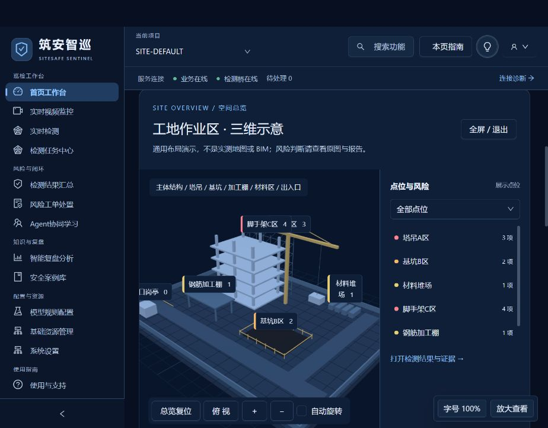
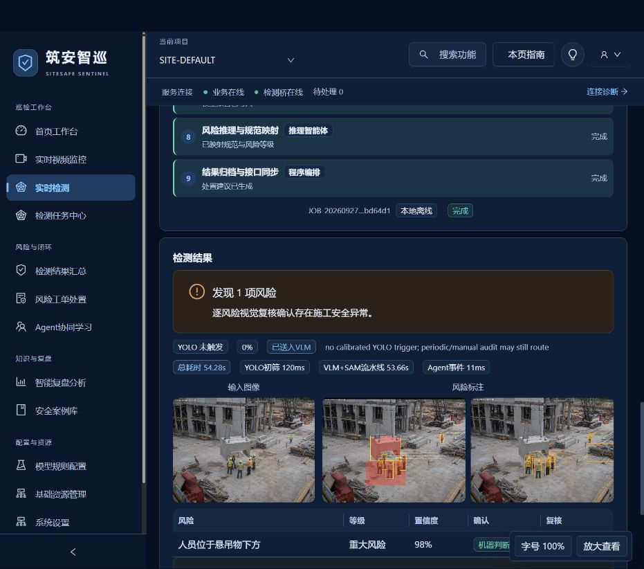
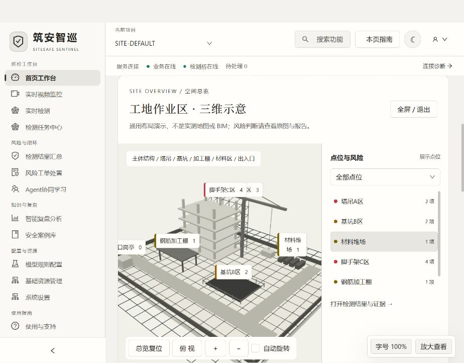
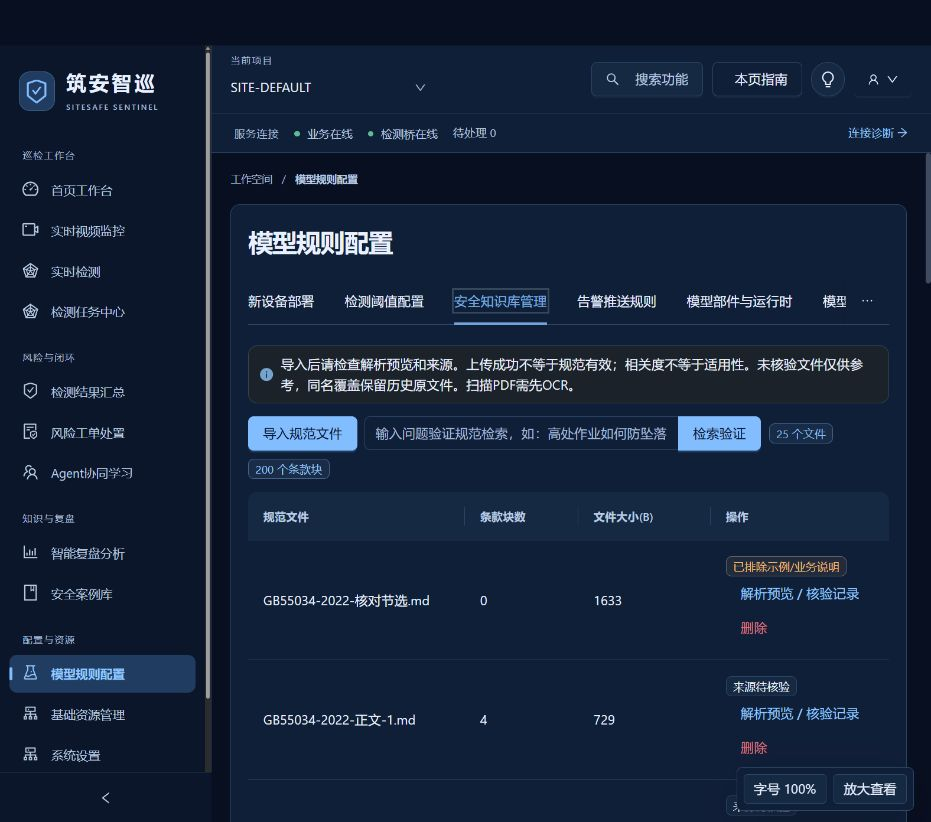
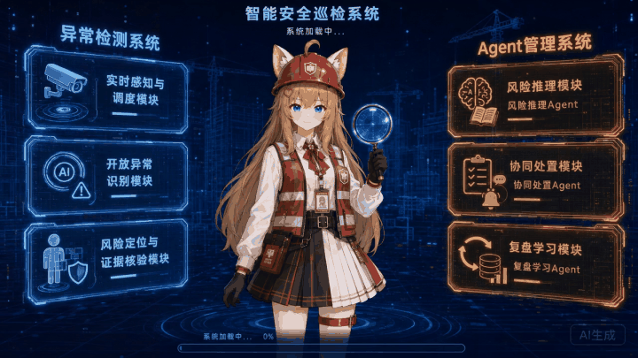

# 筑安智巡 · SiteSafe Sentinel

**面向开放施工风险的多模态安全监管智能体**

从工地画面发现风险，将图像证据、规范出处和处置记录交给安全员核查。

An open-risk visual detection and multi-agent safety management platform for construction sites.

[下载 Windows 安装版 v1.5.2](https://github.com/Shrek2356/SiteSafe-Sentinel/releases/download/v1.5.2/SiteSafe-Sentinel_Setup_v1.5.2_x64.exe) · [版本说明与校验值](https://github.com/Shrek2356/SiteSafe-Sentinel/releases/tag/v1.5.2) · [源码演示](#源码演示) · [系统架构与使用说明](./combine/ZNT/docs/系统架构与使用说明.md)



*v1.5.2 桌面工作台截图。三维工地和摄像头点位为演示布局。*

## 先选体验方式

| 方式 | 适合场景 | 从哪里开始 |
|---|---|---|
| **Windows 安装版 v1.5.2** | 快速体验桌面工作台、双主题、预置案例和规范管理 | 下载 EXE，安装后从桌面快捷方式打开；不需要另装 Node 或准备模型权重即可体验演示模式 |
| **`main` 源码（PC 端 1.5.3）** | 查看代码和完整三维交互场景 | 按下方[源码演示](#源码演示)配置 Python、Node 和依赖；这些源码更新没有并入 v1.5.2 安装器 |
| **真实检测** | 检查自己的现场图像 | 进入「模型规则配置 → 新设备部署」，准备完整推理环境、模型权重或云端服务配置 |

GitHub 的 **Code → Download ZIP** 是源码，不是免配置运行包。安装器不含模型权重，未进行团队代码签名；升级前建议退出旧版并备份工作空间。[安装与迁移说明](./combine/ZNT/desktop/installer/安装版使用说明.md)

## 从检测到整改

1. **分层巡检**：摄像头由 YOLO 初筛，疑似风险按需深查；也支持图片直入和定期全图检查。
2. **开放风险识别**：Qwen 提取可见事实与风险描述，程序将描述编译为 RiskSpec 定位任务；SAM3 提供实体位置，程序结合空间关系、装备关联与可见性检查组织证据。CLIP 可选，用于图像与提示词一致性辅助。
3. **规范溯源与处置**：RAG 检索规范原文，保留版本和出处；安全员确认后可指派整改、收集反馈并复验销项。
4. **复盘学习**：确认和驳回记录进入复盘，达到条件时生成阈值调整建议，经管理员审批后生效。

完整分工、字段交接及配置方式见[系统架构与使用说明](./combine/ZNT/docs/系统架构与使用说明.md)。

## 界面展示

**检测证据**：对照原图、定位结果和风险描述，进入人工复核和工单处置。



<details>
<summary>黑白水墨主题</summary>



</details>

<details>
<summary>规范导入与来源核验</summary>



</details>

<details>
<summary>登录动画</summary>

[](./combine/ZNT/video/%E5%80%99%E6%9C%BA%E5%8A%A8%E7%94%BB.mp4)

</details>

**源码三维场景**：在工作台查看分区和模拟监控点，可操作无人机巡航、视角跟随、截图与全屏。[场景预览图](./3D/预览.png) · [交互文件与模型](./3D) · [平台接入说明](./3D/平台接入说明.txt)

预置案例可离线查看；静态案例关联的摄像头画面不代表实时在线。新图片检测请使用真实检测模式。

## 源码演示

在 Windows 上安装 Node.js 22.12+ 或 24，并将 `node`、`npm` 加入 PATH。然后在仓库根目录的 Anaconda Prompt 中执行：

```bat
conda create -n sitesafe python=3.12 -y
conda activate sitesafe
cd combine\ZNT
python -m pip install -r requirements\detect-bridge.txt
cd pc-admin
npm ci
cd ..
start-sitesafe-demo.bat
```

打开 `http://127.0.0.1:5173/login`，演示管理员为 `admin / admin123`。先到「检测结果汇总」看预置案例，或在「实时检测」选择演示模式走一遍流程。启动器支持 `SITESAFE_PYTHON` 和 `SITESAFE_NODE` 指定本机可执行文件。

大屏与移动端需要分别在 `big-screen/` 和 `mobile/` 安装 npm 依赖，再从 `combine/ZNT/` 运行 `start-sitesafe-demo.bat --displays`。各端入口见[应用目录说明](./combine/ZNT/README.md)。

## 文档导航

| 需要了解 | 文档 |
|---|---|
| 系统模块、数据流程、操作入口 | [系统架构与使用说明](./combine/ZNT/docs/系统架构与使用说明.md) |
| 新机模型部署与运行依赖 | [部署指南](./combine/ZNT/requirements/DEPLOYMENT_GUIDE.md) · [已验证环境](./combine/ZNT/requirements/TESTED_ENVIRONMENT.md) |
| 规范导入、溯源与证据报告 | [知识库使用说明](./combine/ZNT/docs/规范管理与证据报告使用说明.md) |
| 桌面开发、安装包与迁移 | [桌面开发](./combine/ZNT/desktop/README.md) · [安装版使用说明](./combine/ZNT/desktop/installer/安装版使用说明.md) |
| 检测桥与业务对接 | [对接指南](./combine/ZNT/docs/对接指南.md) · [YOLO–VLM–前端整合](./combine/ZNT/docs/YOLO-VLM-前端接口整合说明.md) |
| 版本与验证记录 | [变更记录](./CHANGELOG.md) · [v1.5.2 更新说明](./combine/ZNT/docs/桌面版v1.5.2更新说明.md) · [自动回归工作流](./.github/workflows/regression.yml) |

## 授权说明

本项目为**源码可见的专有软件，并非开源软件**。版权归 SiteSafe-Sentinel 项目作者及依法享有权利的贡献者所有。仓库公开可见不代表授予商用、再分发或生产部署许可。

完整授权范围见 [LICENSE](./LICENSE)，第三方组件、模型、数据与素材说明见 [THIRD_PARTY_NOTICE.md](./THIRD_PARTY_NOTICE.md)。
